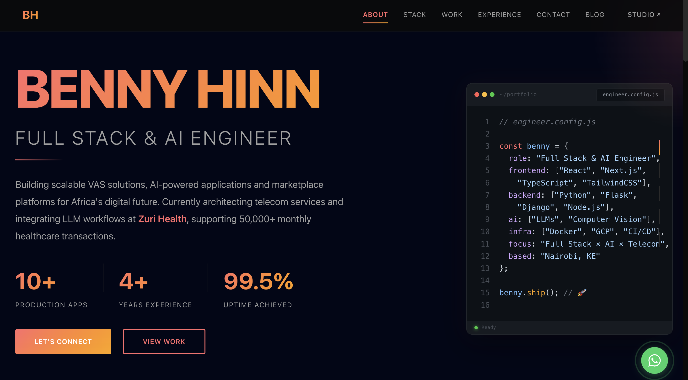

# Benny Hinn - Portfolio Website

The portfolio of a full-stack and AI engineer in Nairobi. The home page (`/`) is a small 3D house a visitor walks into, built with three.js. The original one-page slide portfolio lives at `/classic` and is always one click away ("Skip to site").



> **Work in progress:** the 3D house is being built on the `feat/home` branch. The walkway, the rooms, moving between them, the skills bookshelf, the projects gallery and the music studio are done; the desk comes next.

## 🌟 Features

- **3D home page** - A dusk walkway with a mailbox (opens the contact form) and a front door (walks the camera inside). Lighting is baked in Blender, so the scene is drawn unlit and stays cheap on phones
- **Never trapped** - "Skip to site" on every screen, and the same content rendered as plain HTML under the canvas for search engines, screen readers and devices without WebGL
- **Classic page at `/classic`** - Slide-based navigation with mouse wheel, keyboard arrows or navigation dots
- **Blog** - Markdown posts in `content/blog/`
- **Shared content** - The house and the classic page read the same data files in `constants/`
- **Responsive and accessible** - Touch targets of 44px on touch screens, reduced-motion support, keyboard-reachable controls

## 🛠️ Tech Stack

- **Framework:** Next.js 15.0.6, React 19
- **3D:** three.js, @react-three/fiber, @react-three/drei
- **3D assets:** Blender (modelling and Cycles light baking, scripted in Python), gltf-transform (meshopt geometry, WebP textures)
- **Styling:** TailwindCSS 3.4.1, CSS modules for the house
- **Email:** Resend (`/api/contact`)
- **Deployment:** Vercel (recommended)

## 📋 Prerequisites

Before you begin, ensure you have the following installed:

- Node.js 18.x or higher
- npm or yarn package manager

## 🚀 Getting Started

### Installation

1. Clone the repository:

```bash
git clone https://github.com/coderbenny/bennyhinn.life.git
cd portfolio
```

2. Install dependencies:

```bash
npm install
# or
yarn install
```

3. Add your profile image:

- Place your profile photo in the `public` folder
- Recommended size: 400x500px or similar aspect ratio
- Format: JPG, PNG, or WebP

4. Run the development server:

```bash
npm run dev
# or
yarn dev
```

5. Open [http://localhost:3000](http://localhost:3000) in your browser

### Building for Production

```bash
npm run build
npm start
```

## 📁 Project Structure

```
bennyhinn.life/
├── app/
│   ├── page.js               # "/" : the 3D house, plus the same content as HTML
│   ├── classic/page.js       # "/classic" : the one-page slide portfolio
│   ├── blog/                 # Blog index and posts
│   ├── about/, contact/      # Other pages
│   ├── api/contact/          # Contact form endpoint (Resend)
│   └── layout.js             # Root layout and metadata
├── components/
│   ├── house/                # The 3D home: House, Walkway, CameraRig, Sky, LetterPanel, HouseLoader, HomeContent
│   ├── slides/               # Slides of the classic page
│   ├── ui/                   # Shared UI pieces
│   └── ClassicHome.js        # The classic page
├── constants/                # Content shared by the house and the classic page (projects, skills, experience, music, contact)
├── content/blog/             # Blog posts in Markdown
├── scripts/blender/          # Blender scripts that model and bake the house
└── public/house/             # Compressed 3D models served to the browser
```

## 🏠 The 3D house

The scene is modelled and lit in Blender from Python scripts, with the lighting baked into textures. Nothing is modelled by hand, so the whole asset can be rebuilt from the scripts.

Requirements: Blender on your `PATH` (`brew install --cask blender`) and the dev dependencies (`npm install`).

```bash
npm run house            # all three steps below
npm run house:model      # scripts/blender/walkway.py       -> art/walkway.blend
npm run house:bake       # scripts/blender/bake_walkway.py  -> art/walkway-raw.glb (Cycles bake, about an hour)
npm run house:compress   # gltf-transform                   -> public/house/walkway.glb
```

`art/` holds the Blender working files and is not committed, since the scripts rebuild it. Only `public/house/*.glb` is committed. Keep the model under 3 MB.

The camera moves between spots (outside, entry, living room, gallery, studio, desk) defined in `components/house/spots.js`. Each spot has its own address, such as `/?room=studio`. Positions in that file are in three.js coordinates: a Blender point (x, y, z) is (x, z, -y) there.

The skills bookshelf in the living room is drawn from `constants/skills.js` (`TECH_STACK` and `SKILL_DETAILS`); a book's thickness counts the projects and roles that use it. The projects gallery hangs one frame per project in `constants/projects.js` (`components/house/galleryLayout.js`). Its pictures are small WebP copies of the screenshots in `public/projects/`; run `npm run house:frames` after adding or changing a project's screenshot.

The studio hangs one vinyl record per track in `constants/music.js` on its back wall (`components/house/recordWall.js`); each opens the track on Spotify. The covers in `public/house/records/` are fetched from Spotify's public oEmbed endpoint (no login or app needed); run `npm run house:records` after adding a track.

`npm run test:house` checks the routes between rooms, that every skill fits on the shelf, that every project fits on the gallery walls and has its picture, and that every track fits on the record wall and has its cover.

In development, `window.__house` and `window.__houseCamera` let test scripts freeze the door and flag and place the camera.

## 🎨 Customization

### Personal Information

Content lives in `constants/` and is shared by the house and the classic page:

**projects.js** - Projects
**skills.js** - Technologies
**experience.js** - Work experience
**music.js** - Tracks (Spotify)
**contact.js** - Email and social links

### Color Theme

The portfolio uses a coral/amber gradient theme. To customize colors, edit the CSS variables in `globals.css`:

```css
:root {
  --coral-500: #ff6b6b;
  --coral-400: #ff8787;
  --amber-500: #ffa500;
  --amber-400: #ffb733;
  --bg-primary: #0a0a0a;
  --bg-secondary: #141414;
  --text-primary: #ffffff;
  --text-secondary: #a0a0a0;
  --border-color: #2a2a2a;
}
```

### Typography

The portfolio uses the Inter font family. To change fonts, update the Google Fonts link in `app/layout.js`:

```javascript
<link
  href="https://fonts.googleapis.com/css2?family=YourFont:wght@300;400;600;700;800&display=swap"
  rel="stylesheet"
/>
```

## 🎯 Key Components

### Navigation System

- **Mouse Wheel:** Scroll up/down to navigate between slides
- **Keyboard:** Use arrow keys (↑/↓) to navigate
- **Indicators:** Click the dots on the right side
- **Top Nav:** Click section names in the navigation bar

### Responsive Breakpoints

- **Mobile:** < 768px
- **Tablet:** 768px - 1024px
- **Desktop:** > 1024px
- **Large Desktop:** > 1440px
- **Ultra-wide:** > 1920px

## 📱 Browser Support

- Chrome (latest)
- Firefox (latest)
- Safari (latest)
- Edge (latest)
- Mobile browsers (iOS Safari, Chrome Mobile)

## ♿ Accessibility

- Keyboard navigation support
- ARIA labels for interactive elements
- Focus indicators for all clickable elements
- Reduced motion support for users with motion sensitivity
- High contrast mode support
- Semantic HTML structure

## 🚀 Deployment

### Vercel (Recommended)

1. Push your code to GitHub
2. Import your repository on [Vercel](https://vercel.com)
3. Vercel will automatically detect Next.js and configure the build
4. Deploy!

### Other Platforms

The project can be deployed on any platform that supports Next.js:

- Netlify
- AWS Amplify
- Google Cloud Run
- Digital Ocean App Platform

Build command: `npm run build`  
Output directory: `.next`

## 📊 Performance

- **Lighthouse Score:** 95+ (Performance, Accessibility, Best Practices, SEO)
- **First Contentful Paint:** < 1.5s
- **Time to Interactive:** < 3.5s
- **Bundle Size:** Optimized with Next.js automatic code splitting

## 🐛 Known Issues

- Cursor glow effect is disabled on touch devices for better performance
- Some animations may be reduced on devices with `prefers-reduced-motion` enabled

## 🤝 Contributing

This is a personal portfolio project, but suggestions and feedback are welcome!

1. Fork the project
2. Create your feature branch (`git checkout -b feature/AmazingFeature`)
3. Commit your changes (`git commit -m 'Add some AmazingFeature'`)
4. Push to the branch (`git push origin feature/AmazingFeature`)
5. Open a Pull Request

## 📄 License

This project is open source and available under the [MIT License](LICENSE).

## 📧 Contact

**Benny Hinn**  
Full Stack Software Engineer | VAS Solutions Developer

- Email: bhinnexclusive@gmail.com
- Phone: +254-114-092-304
- LinkedIn: [linkedin.com/in/benny-mathew](https://www.linkedin.com/in/benny-mathew)
- GitHub: [github.com/coderbenny](https://github.com/coderbenny)
- Portfolio: [https://www.bennyhinn.life](https://www.bennyhinn.life)

**Location:** Nairobi, Kenya

---

## 🙏 Acknowledgments

- Inter font by [Rasmus Andersson](https://rsms.me/inter/)
- Icons from [Heroicons](https://heroicons.com/)
- Inspiration from modern portfolio designs and contemporary web trends

---

**Built with ❤️ by Benny Hinn**

_Last Updated: November 2026_
